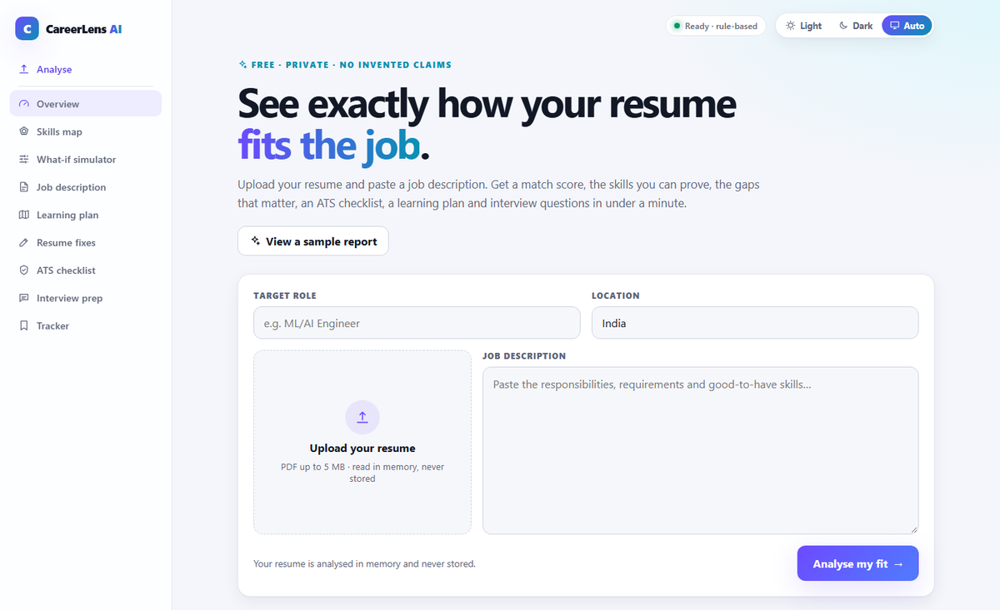
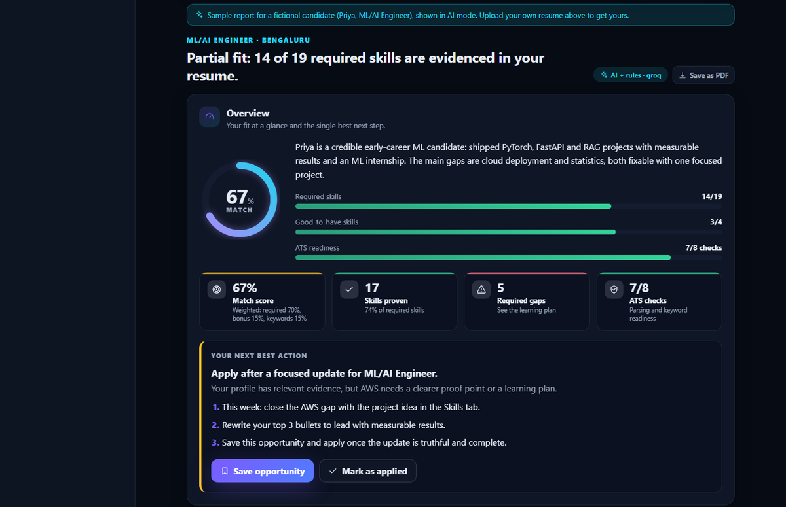
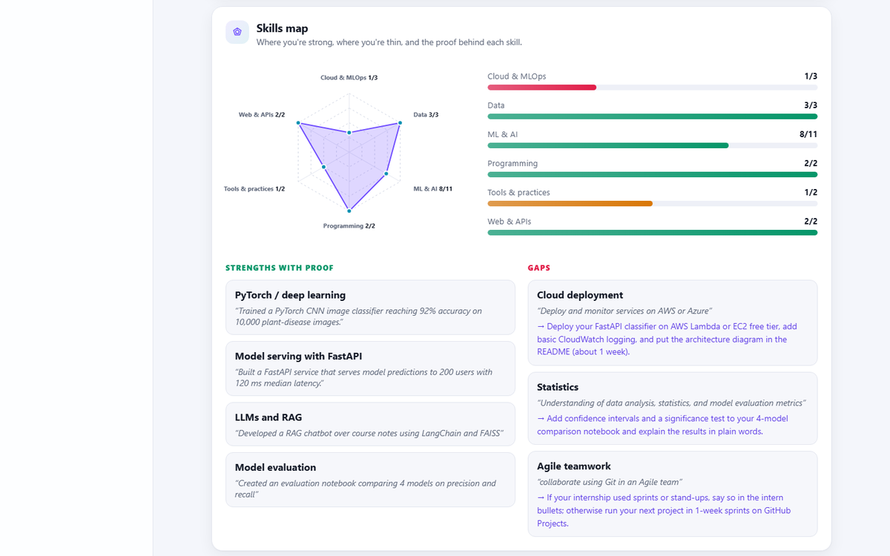
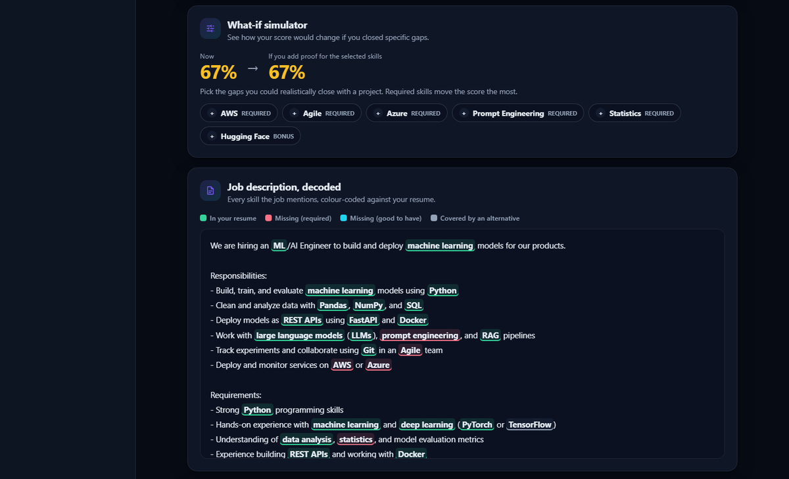
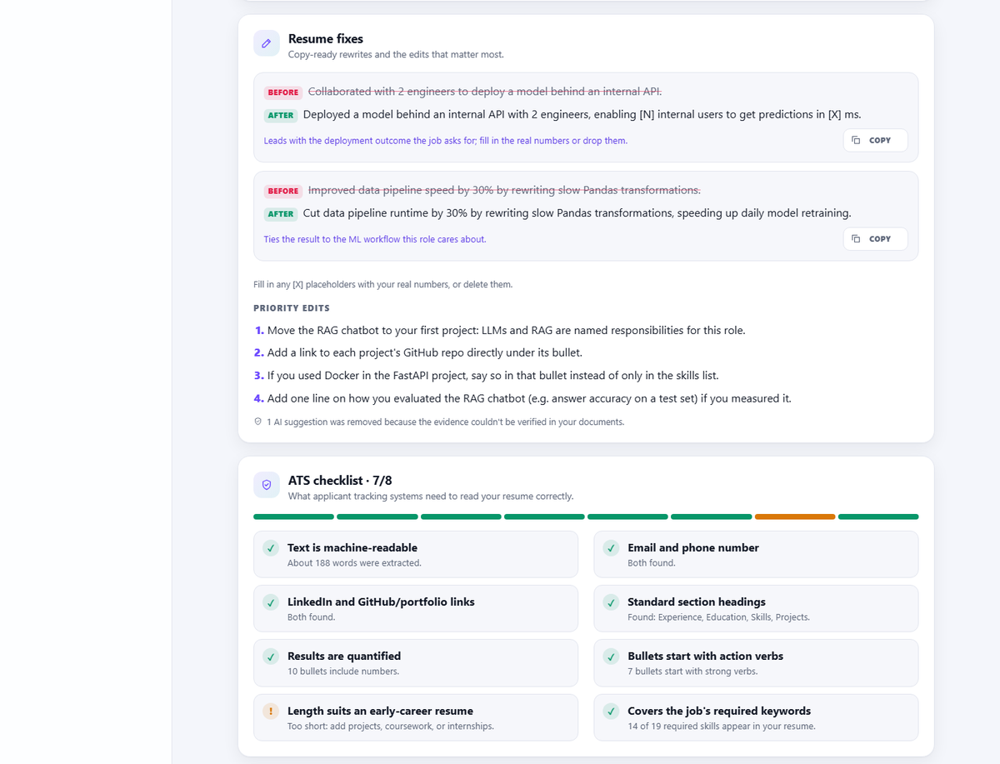

# CareerLens AI

**See exactly how your resume fits a job, with evidence for every claim.**

### 👉 Try it: **[careerlens-ai-lite.netlify.app](https://careerlens-ai-lite.netlify.app)**
No resume handy? Open the **[sample report](https://careerlens-ai-lite.netlify.app/?sample=1)**. API docs: [careerlens-ai-z6xa.onrender.com/docs](https://careerlens-ai-z6xa.onrender.com/docs)



Free, private, and open source. Upload a resume PDF, paste a job description, and get:

| | |
|---|---|
| **Overview** | Match score, required vs good-to-have coverage, ATS readiness, and your next best action |
| **Skills map** | Radar chart by area (ML & AI, Cloud & MLOps, Data…), every matched skill with the resume line that proves it |
| **What-if simulator** | Pick the gaps you could close and watch the score update |
| **Job description, decoded** | The job post with every skill highlighted: in your resume, missing, or covered by an alternative |
| **Learning plan** | A week-by-week plan of small, free projects that close the gaps |
| **Resume fixes** | Copy-ready before/after bullet rewrites and priority edits |
| **ATS checklist** | 8 checks for parsing and keyword readiness |
| **Interview prep** | Questions this interviewer is likely to ask *you* |

Light and dark themes (or follow your device), a sidebar to jump between sections, Save as PDF, and a local application tracker.

## Screenshots

| Overview (dark) | Skills map (light) |
|---|---|
|  |  |
| **What-if simulator & job decoder (dark)** | **Resume fixes & ATS checklist (light)** |
|  |  |

## Why it's different

Most resume tools give a black-box score and generic tips, and some will happily "optimise" your resume with skills you don't have. CareerLens is built around **evidence**:

- **Every strength quotes your resume; every gap quotes the job description.** The backend verifies each quote against the real text and drops anything it can't find.
- **AI rewrites can't invent facts.** A rewrite is rejected if it adds a skill or a number that isn't in your original bullet; missing metrics become `[X]` placeholders.
- **Smart matching, not keyword counting.** "PyTorch *or* TensorFlow" is one requirement; a PyTorch project counts as machine-learning evidence; skills that only sit in a skills list are flagged "listed only".
- **Transparent score.** Required skills 70%, good-to-have 15%, keyword overlap 15%. The what-if simulator uses the same formula.

## How it works

```text
Browser: React + TypeScript (Netlify)
   │  resume PDF + job description
   ▼
FastAPI backend (Render)
   ├─ Rate limit (per visitor) and PDF validation
   ├─ PDF text extraction (PyMuPDF, in memory, never stored)
   ├─ Rule-based matcher: 49 skills, required vs good-to-have, alternatives, implied skills
   ├─ ATS checker: 8 parsing and keyword checks
   └─ AI analysis: Groq → Gemini fallback → guardrails verify every quote → JSON
```

The rule-based report always works, even with no AI key, and doubles as a benchmark for the AI output.

## AI providers (optional, free)

Set one or more keys on the backend. With several keys, they back each other up: if the first fails or hits its free-tier limit, the request is retried on the next.

| Provider | Env var | Default model | Cost |
|---|---|---|---|
| Groq | `GROQ_API_KEY` | `openai/gpt-oss-120b` | Free tier |
| Google Gemini | `GEMINI_API_KEY` | `gemini-3.5-flash-lite` | Free tier |
| Anthropic Claude | `ANTHROPIC_API_KEY` | `claude-opus-5-5` | Paid |

`CAREERLENS_LLM_PROVIDER` moves one provider to the front; `CAREERLENS_LLM_MODEL` overrides its model. See [docs/deployment.md](docs/deployment.md) for getting free keys.

## Run locally

```powershell
# Backend
cd backend
python -m venv .venv; .venv\Scripts\pip install -r requirements.txt
copy .env.example .env      # optional: add GROQ_API_KEY / GEMINI_API_KEY
.venv\Scripts\python.exe -m uvicorn app.main:app --reload

# Frontend (second terminal)
cd frontend; npm install; npm run dev     # http://localhost:5173
```

Tests: `cd backend; .venv\Scripts\python.exe -m unittest discover -s tests`

## Hosting (all free)

- Frontend on **Netlify**, backend on **Render**. Every push to `main` redeploys both.
- A scheduled **GitHub Action** ([keep-api-warm.yml](.github/workflows/keep-api-warm.yml)) pings the API every 10 minutes so the free server doesn't fall asleep between visitors.
- Full setup: [docs/deployment.md](docs/deployment.md).

## Security and privacy

Resumes are processed in memory and never stored; API keys live only on the server; the analyse endpoint is rate-limited. Details and how to report a vulnerability: [SECURITY.md](SECURITY.md).

## Limitations

- The skill catalogue focuses on tech, data and ML roles; other fields rely more on the AI analysis.
- There is no universal "ATS score". The checklist covers what reliably helps parsing and keyword filters.
- Scanned (image-only) PDFs can't be read.

## Credits

Designed and built by **Murariji Dubey**, with **Claude** (Anthropic) as an AI pair programmer.

## License

[MIT](LICENSE) © 2026 Murariji Dubey
